<b>English</b> · <a href="README_CN.md">简体中文</a>

  <b>A data-driven HTML/CSS UI framework for games and real-time applications.</b> 
  Unreal Engine · Unity · C++ · C#

  <a href="https://endink.github.io/MarkupUI/">Documentation</a> ·
  <a href="docs/ue/getting-started/quick-start.md">Unreal Engine</a> ·
  <a href="docs/unity/getting-started/quick-start.md">Unity</a> ·
  <a href="https://github.com/endink/MarkupUI/issues">Issues</a>

## Markup UI

Markup UI uses HTML for interface structure and CSS for layout and styling. Hardware-accelerated rendering, data binding, and commands connect those interfaces to application logic. Build menus, inventories, settings panels, and other game interfaces while keeping page design separate from C++ or C# code.

- **HTML and CSS** — define page structure, reusable styles, layouts, and assets.
- **Data binding** — connect text, attributes, styles, conditions, and collections to application data.
- **UI interaction** — write input values back to models and invoke commands from UI events; use triggers to connect application events to page behaviors.
- **Engine integration** — work with Unreal Engine through UMG and with Unity through UI Toolkit, including engine-specific asset and preview workflows.
- **C++ and C#** — expose observable data and typed commands through the SDK and engine integrations.

## Engine integrations

### Unreal Engine

Display HTML interfaces in UMG, preview pages in the editor, and bind them to game data. Use Unreal Engine properties, commands, and extension properties to connect page content and interaction to gameplay logic.

[Install](docs/ue/getting-started/install.md) · [Create your first interface](docs/ue/getting-started/quick-start.md) · [Display in UMG](docs/ue/usage/umg.md)

### Unity

Display HTML interfaces through UI Toolkit, synchronize page assets into the project, and preview them in the editor. Use C# data models and commands to connect interfaces to application logic.

[Install](docs/unity/getting-started/install.md) · [Create your first interface](docs/unity/getting-started/quick-start.md) · [Integrate with UI Toolkit](docs/unity/usage/ui-toolkit.md)

## From data to interaction

Templates describe what the interface displays. Data binding keeps page content connected to observable application data, while two-way binding writes user input back to the model. Commands let UI events invoke business operations; triggers let application events execute behaviors on page elements.

This supports interfaces such as inventories, player status panels, settings screens, and in-game menus, with presentation defined in HTML/CSS and application behavior implemented in C++ or C#.

[Write your first page](docs/authoring/first-page.md) · [Data binding](docs/binding/getting-started.md) · [Events and commands](docs/binding/events-and-commands.md) · [Triggers](docs/binding/triggers.md)

## Documentation and feedback

Explore the [documentation](https://endink.github.io/MarkupUI/) for setup, template syntax, and platform-specific capabilities. Report bugs, ask questions, or suggest features in [Issues](https://github.com/endink/MarkupUI/issues).
