<a href="README.md">English</a> · <b>简体中文</b>

  <b>面向游戏与实时应用的数据驱动 HTML/CSS 用户界面框架。</b> 
  Unreal Engine · Unity · C++ · C#

  <a href="https://endink.github.io/MarkupUI/">在线文档</a> ·
  <a href="docs/ue/getting-started/quick-start.md">Unreal Engine</a> ·
  <a href="docs/unity/getting-started/quick-start.md">Unity</a> ·
  <a href="https://github.com/endink/MarkupUI/issues">问题反馈</a>

## Markup UI

Markup UI 使用 HTML 定义界面结构，使用 CSS 设置布局与样式，通过硬件加速渲染、数据绑定和命令将界面连接到应用逻辑。可以用于菜单、背包、设置面板等游戏界面，使页面设计与 C++ 或 C# 业务代码分开维护。

- **HTML 与 CSS**：定义页面结构、布局、可复用样式和资产引用。
- **数据绑定**：将文本、属性、样式、条件和集合连接到应用数据。
- **UI 交互**：将输入值写回模型，通过界面事件调用命令，也可用触发器将业务事件连接到页面行为。
- **引擎集成**：在 Unreal Engine 中通过 UMG 显示，在 Unity 中通过 UI Toolkit 显示，并提供各平台的资产与编辑器预览工作流。
- **C++ 与 C#**：通过 SDK 和引擎适配提供可观察数据及强类型命令。

## 引擎支持

### Unreal Engine

**支持使用蓝图连接界面与游戏逻辑**：绑定蓝图对象的属性，将页面事件关联到蓝图函数，并通过蓝图节点发送属性更改通知。通过 UMG 显示 HTML 界面，在编辑器中预览页面；也可使用 C++ 属性、`UFUNCTION` 和扩展属性接入已有游戏系统。

[安装与项目准备](docs/ue/getting-started/install.md) · [第一个游戏界面](docs/ue/getting-started/quick-start.md) · [在 UMG 中显示页面](docs/ue/usage/umg.md)

### Unity

通过 UI Toolkit 显示 HTML 界面，将页面资产同步到工程，并在编辑器中预览。使用 C# 数据模型和命令，将界面连接到应用逻辑。

[安装与项目准备](docs/unity/getting-started/install.md) · [第一个游戏界面](docs/unity/getting-started/quick-start.md) · [接入 UI Toolkit](docs/unity/usage/ui-toolkit.md)

## 从数据到交互

模板描述界面显示的内容。数据绑定将页面内容连接到可观察的应用数据，双向绑定将用户输入写回模型。命令让界面事件调用业务操作，触发器让应用事件执行页面元素上的行为。

这些功能可用于背包、玩家状态面板、设置界面和游戏菜单等场景：使用 HTML/CSS 定义呈现方式，使用 C++ 或 C# 实现业务逻辑。

[编写第一个页面](docs/authoring/first-page.md) · [数据绑定](docs/binding/getting-started.md) · [事件与命令](docs/binding/events-and-commands.md) · [触发器](docs/binding/triggers.md)

## 文档与反馈

通过[在线文档](https://endink.github.io/MarkupUI/)了解安装配置、模板语法及各平台的功能支持。问题、建议和功能需求可提交到 [Issues](https://github.com/endink/MarkupUI/issues)。
