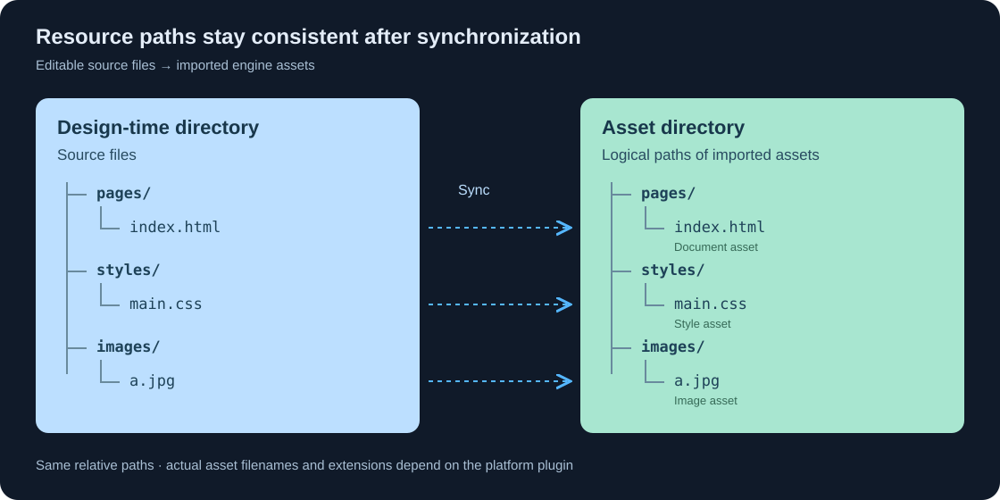

# 资源路径

资源路径用于定位 HTML 页面引用的 CSS、图片和字体。页面中的路径描述资源在目录中的相对位置，不需要写入设计文件在电脑上的完整磁盘路径，也不需要改写为引擎资产的内部名称。

## 设计时目录与资产目录

- **设计时目录**：保存 HTML、CSS、图片和字体源文件，通常由界面设计人员维护，用于编写、调整和迭代界面。
- **资产目录**：保存同步到引擎工程后的资源，通常由开发人员在工程中直接引用，用于资产预览、游戏界面集成和运行时加载。

同步资源时，应保留文件相对于`设计时目录`的位置，使其与`资产目录`内的逻辑路径对应。例如：



右侧表示资源的逻辑路径关系，实际资产文件名或后缀由平台插件处理。页面作者仍使用 `pages/index.html`、`styles/main.css` 和 `images/a.jpg` 等原始资源路径。

`设计时目录`与`资产目录`可以位于不同位置，也不必使用相同的目录名。保持一致的是两个目录内部的资源路径，而不是它们本身的磁盘位置。

!!! note "资源查找不在两个目录间自动切换"
    资产预览和运行时加载使用配置的`资产目录`。资源在`资产目录`中缺失时，不会因为`设计时目录`中存在同名文件就自动从那里读取。

## 根路径

以 `/` 开头的路径表示从全局配置的 `资产目录` 开始查找，适用于资产预览和运行时加载。所有页面共用这一配置，不按页面单独设置。

```html

```

`/a.jpg` 表示查找`资产目录`根部的 `a.jpg`。如果文件位于`资产目录`下的 `images` 子目录，应使用 `/images/a.jpg`。

| 页面中的路径 | `资产目录`中的逻辑位置 |
| --- | --- |
| `/a.jpg` | `资产目录/a.jpg` |
| `/images/a.jpg` | `资产目录/images/a.jpg` |
| `/styles/main.css` | `资产目录/styles/main.css` |

根路径与引用它的 HTML 或 CSS 文件所在子目录无关。例如，`pages/index.html` 与 `pages/menu/index.html` 中的 `/images/a.jpg` 指向同一份资源。

!!! note "这里的根不是磁盘根目录"
    `/` 表示全局配置的 `资产目录`，不表示系统盘或工程根目录。`设计时目录`用于维护和同步源文件，不是资产加载失败后的备用查找位置。

## 相对路径

不以 `/` 开头的路径相对于**直接引用该资源的文件所在目录**解析。

假设 HTML 的逻辑位置为 `pages/index.html`：

| 引用路径 | 解析结果 |
| --- | --- |
| `a.jpg` 或 `./a.jpg` | `pages/a.jpg` |
| `images/a.jpg` | `pages/images/a.jpg` |
| `../images/a.jpg` | `images/a.jpg` |
| `/images/a.jpg` | `images/a.jpg`，直接从`资产目录`查找 |

`..` 表示返回上一级目录。它可以在`资产目录`内部使用，但不能越过`资产目录`访问其他文件。

## CSS 中的资源路径

HTML 引用 CSS 时，路径相对于 HTML 文件。例如，`pages/index.html` 通过 `../styles/main.css` 引用样式表：

```html
<!-- pages/index.html -->
<link rel="stylesheet" href="../styles/main.css">
```

外部 CSS 引用图片或字体时，路径相对于 CSS 文件自身。例如，`styles/main.css` 通过 `../images/a.jpg` 引用图片：

```css
/* styles/main.css */
.banner {
  background-image: url("../images/a.jpg");
}
```

两次引用分别从 `pages/` 和 `styles/` 出发。不能将外部 CSS 中的所有资源路径都按入口 HTML 所在目录解释。

若希望引用不受 CSS 所在子目录变化影响，也可写为 `url("/images/a.jpg")`，从当前`资产目录`查找。

## 路径维护

- 使用 `/` 作为目录分隔符，保持文件名和大小写一致。
- 移动 HTML 或 CSS 后，检查其相对引用；移动资源后，检查所有引用位置。
- 修改设计文件后重新同步资产，避免只更新文档却遗漏样式、图片或字体。
- 不在页面中填写本机绝对路径，也不依赖资产目录之外的文件。

详细信息请阅读各平台文档。
