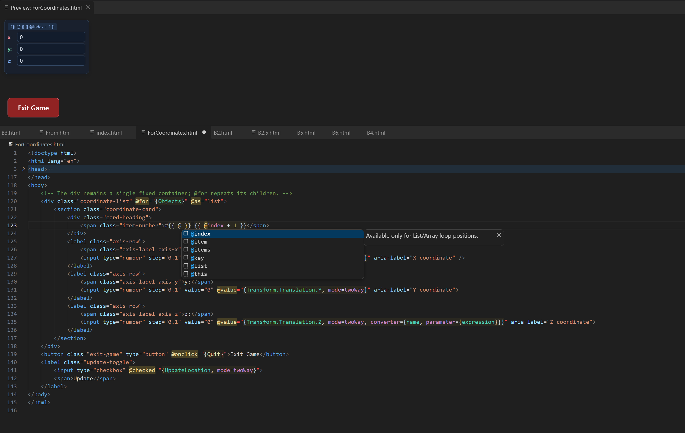

# VS Code 插件

Markup UI 的 VS Code 插件提供 HTML 绑定模板的语法高亮、补全、悬浮说明、诊断和 HTML/CSS 预览。

[](images/vscode-template-preview.png)

## 安装与启用

1. 在 VS Code 的扩展视图中，选择 **Install from VSIX...（从 VSIX 安装）**，安装提供的 `.vsix` 文件。
2. 打开包含`设计时目录`的工作区。
3. 创建 `.mk.html` 文件，自动启用模板支持；已有 `.html` 文件可通过命令面板执行 **MarkupUI: 启用模板支持**。

## 编写绑定模板

- **语法高亮**：区分 `@`／`mk:` 指令、绑定表达式和普通 HTML。
- **补全**：输入 `@` 或 `mk:` 选择指令，在绑定中补全选项、选项值和作用域符号。
- **悬浮说明与诊断**：查看指令用法，检查绑定选项、条件分支和作用域等常见问题。
- **HTML/CSS 编辑**：保留 HTML 与 CSS 的补全和悬浮说明。

```html
<p @text="{Name}">Player name</p>
<input @value="{Name, mode=twoWay}">
```

插件不提供业务对象属性的成员补全，诊断也不替代运行时校验。

## 预览 HTML/CSS

点击编辑器右上角的**预览按钮**，或执行 **MarkupUI: 切换预览**。预览显示在代码上方，跟随当前活动的 HTML 或模板文件；编辑模板后自动刷新，外部 CSS 和图片等文件保存后刷新。

!!! info "静态预览"
    预览只显示 HTML/CSS，不执行数据绑定、条件、循环、命令或页面脚本。保留文本插值和设计时占位内容；实际渲染和交互应在平台插件中验证。

## 虚拟根路径

通过 `markupui.preview.resourceRoot` 指定预览使用的`设计时目录`，让 `/styles/main.css`、`/images/a.jpg` 等路径从该目录解析，而不是从当前 HTML 所在目录解析。

例如，工作区中的文件位于 `ui/pages/index.mk.html`、`ui/styles/main.css` 和 `ui/images/a.jpg`，在 `.vscode/settings.json` 中配置：

```json
{
  "markupui.preview.resourceRoot": "ui"
}
```

模板可以直接使用根路径：

```html
<link rel="stylesheet" href="/styles/main.css">

```

- **相对目录**：从工作区第一个顶层文件夹计算，例如 `ui`。
- **绝对目录**：可直接指定本机的`设计时目录`。
- **留空**：使用工作区第一个顶层文件夹；未打开工作区时使用当前文件所在目录。

HTML 中的相对路径仍从 HTML 文件所在目录计算；外部 CSS 中的相对路径从 CSS 文件所在目录计算。虚拟根路径只影响编辑器预览，不修改平台插件配置的`资产目录`。

## 其他预览选项

| 设置 | 用途 | 默认值 |
| --- | --- | --- |
| `markupui.preview.allowRemoteResources` | 允许加载远程图片和字体；不展开远程样式表 | `false` |

未保存的文档只能预览内联内容，引用本地资源前需先保存。资源缺失或路径越界时，预览提示区会显示原因。
