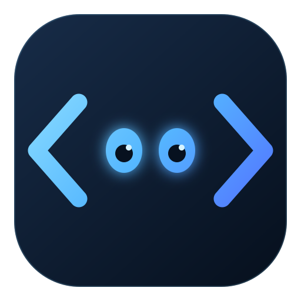

# Markup UI

Markup UI 是面向游戏与实时应用的用户界面框架，使用 HTML 定义界面结构，使用 CSS 设置布局与样式，并提供硬件加速渲染、数据绑定和事件处理功能，使界面设计与业务逻辑相互分离。通过适配不同平台的插件，Markup UI 将资源管理、编辑器预览和运行时界面显示集成到开发环境中，支持使用统一的页面格式构建应用界面。

<!-- 后续补充 UE / Unity 界面效果图。 -->

## :bootstrap-play-circle: 开始使用

### Unreal Engine

通过文档资产管理页面，在编辑器中预览，并使用 UMG 控件显示界面。

[安装与项目准备](ue/getting-started/install.md) · [第一个游戏界面](ue/getting-started/quick-start.md) · [在 UMG 中显示页面](ue/usage/umg.md)

### Unity

将 HTML、CSS 及相关资源同步到工程，在 HTML 资产窗口中预览，并通过 UI Toolkit 显示界面。

[安装与项目准备](unity/getting-started/install.md) · [第一个游戏界面](unity/getting-started/quick-start.md) · [接入 UI Toolkit](unity/usage/ui-toolkit.md)

## HTML 与布局

- [基本概念](concepts/pages-and-resources.md)
- [编写第一个页面](authoring/first-page.md)
- [HTML 文档结构](authoring/html-structure.md)
- [布局与尺寸](authoring/layout-and-styles.md)
- [DPI 与缩放](authoring/sizing-and-scaling.md)

## 样式与资源

- [CSS 样式](authoring/css-styles.md)
- [资源路径](authoring/resource-paths.md)

## 数据绑定

- [数据绑定概述](binding/getting-started.md)
- [数据上下文](concepts/data-context.md)
- [绑定语法](binding/binding-syntax.md)
- [条件绑定](binding/conditions-and-lists.md)

## 输入与事件

- [输入与双向绑定](binding/input-and-two-way-binding.md)
- [事件与命令](binding/events-and-commands.md)

## 编辑器工具与打包

| 操作 | Unreal Engine | Unity |
| --- | --- | --- |
| 资源更新 | [资产同步](ue/resources/asset-synchronization.md) | [同步设计文件](unity/resources/sync-design-files.md) |
| 页面预览 | [编辑器预览](ue/resources/editor-preview.md) | [预览页面资产](unity/resources/editor-preview.md) |
| 性能分析 | [性能采样](ue/troubleshooting/profiling.md) | [性能采样](unity/troubleshooting/profiling.md) |
| 项目构建 | [打包项目](ue/publishing/packaging.md) | [构建 Player](unity/publishing/player-build.md) |

## 参考与版本信息

- [标记与绑定语法](reference/binding-syntax.md)
- [支持范围与限制](reference/support-and-limitations.md)
- [兼容性说明](releases/compatibility.md)
- [更新记录](releases/changelog.md)
- 常见问题：[Unreal Engine](ue/troubleshooting/faq.md) · [Unity](unity/troubleshooting/faq.md)

!!! info "内容状态"
    部分章节目前仅有大纲，正文将后续补充。菜单条目不代表对应功能均已在两个平台完成支持或验证。
