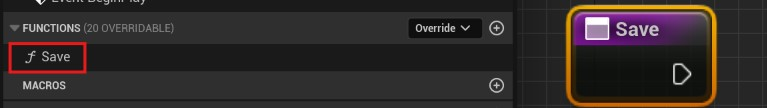

# 命令绑定

Markup UI 原生支持命令绑定，将页面事件关联到数据上下文中的命令，在点击按钮或提交输入时执行应用逻辑，具体用法见[事件与命令](../../binding/events-and-commands.md)。

!!! abstract "调用线程"
    所有命令回调都在**游戏线程**执行。

## UFUNCTION

页面事件可以调用数据对象上符合以下条件的 C++ 或蓝图函数，以执行游戏逻辑。

命令函数需满足以下约束：

- **函数类型**：必须是公开且可从蓝图调用的实例函数。C++ 使用 `UFUNCTION(BlueprintCallable)` 声明。静态函数、委托和网络函数不能作为命令。
- **返回值**：无返回值，C++ 使用 `void`，蓝图不添加返回值。
- **属性访问器**：同样按函数签名判断。无返回值且可从蓝图调用的 `BlueprintSetter` 可以绑定为命令，有返回值的 `BlueprintGetter` 不符合要求。
- **参数类型**：支持标量数值、布尔值、枚举、`FString`、`FName`、`FText`、颜色、向量及 `UObject` 对象引用。
- **参数限制**：不支持普通结构体、集合或可写输出参数；传入参数的数量、顺序和类型必须与函数声明一致。

## 绑定

先将数据对象设置为 **MarkupUI Widget** 的数据上下文，具体操作见[属性绑定](property-binding.md)。例如，数据对象提供一个无参数、无返回值的 `Save` 函数，HTML 中按函数名绑定：

```html
<button @onclick="{Save}">保存</button>
```

使用 `{Save}`，不要写 `{Save()}`。命令名称使用实际函数名。

=== "C++"

    在数据对象的类中声明公开的实例函数，并在实现中执行保存逻辑：

    ```cpp
    public:
        UFUNCTION(BlueprintCallable, Category = "Player")
        void Save();
    ```

    函数需要声明为 `UFUNCTION`；仅有普通 C++ 成员函数无法通过反射绑定。

=== "蓝图"

    1. 在作为数据上下文的蓝图对象中创建函数 `Save`。
    2. 将函数的访问权限设为 **Public**，不添加输入参数或返回值。
    3. 在函数中编写保存逻辑。
    4. 在 HTML 中使用 `@onclick="{Save}"` 绑定该函数。
    下图左侧是 **Functions** 列表中的 `Save` 函数，右侧是函数图中的 `Save` 入口节点。从入口节点的执行引脚连接保存逻辑。

    

## 命令参数

通过 `parameter` 传入属性值。例如，将数据上下文中的 `TargetHealth` 传给 `ApplyHealth`：

```html
<button @onclick="{ApplyHealth, parameter={TargetHealth}}">应用生命值</button>
```

对应的 C++ 声明：

```cpp
UPROPERTY(BlueprintReadWrite, Category = "Player")
int32 TargetHealth = 100;

UFUNCTION(BlueprintCallable, Category = "Player")
void ApplyHealth(int32 Value);
```

蓝图中创建同名函数，并添加一个整数输入参数即可。参数的数量、顺序和类型必须与函数声明一致；多个参数使用 `parameter={FirstValue, SecondValue}`。

命令修改绑定属性后，仍需发送属性更改通知；修改集合时使用相应集合通知，详见[属性绑定](property-binding.md)。

## 执行条件

可以通过条件函数或布尔属性控制命令是否执行。页面事件执行命令前，先查询条件函数；没有对应函数时，再读取同名布尔属性。

### 命名规则

条件成员名为 `Can` 加上命令函数名，定义在同一个数据对象上，无需在 HTML 中额外声明：

- `Save` 对应 `CanSave`。
- `ApplyHealth` 对应 `CanApplyHealth`。
- `{Settings.Save}` 检查的是 `Settings` 对象上的 `CanSave`。

### 条件函数

- 必须是实例 `UFUNCTION`，不能是静态函数或网络函数。
- 不接收任何输入或输出参数，即使命令本身带参数，条件函数也不接收这些参数。
- 必须返回 `bool`；C++ 的 `const` 修饰可选。

例如，`Save` 与其条件函数声明为：

```cpp
public:
    UFUNCTION(BlueprintCallable, Category = "Player")
    void Save();

    UFUNCTION(BlueprintCallable, Category = "Player")
    bool CanSave() const;
```

蓝图中创建函数 `CanSave`，不添加输入参数，只添加一个 **Boolean** 类型的返回值。

### 布尔属性

条件只需要读取一个布尔值时，可以直接提供 `bool` 类型的 `UPROPERTY`，无需额外编写条件函数：

```cpp
public:
    UPROPERTY(EditAnywhere, BlueprintReadWrite, Category = "Player")
    bool CanSave = true;

    UFUNCTION(BlueprintCallable, Category = "Player")
    void Save();
```

蓝图中也可以创建名为 `CanSave` 的 **Boolean** 变量。执行 `Save` 前读取该属性的当前值。

### 查找顺序

1. 查找同一数据对象上的条件函数，例如 `CanSave`。
2. 没有条件函数时，查找同名的布尔属性。
3. 函数和属性都没有时，默认允许执行。

找到条件函数但签名不符合要求，或找到属性但类型不是 `bool` 时，记录错误并拒绝执行，不继续使用其他条件。

### 检查结果

- 条件函数返回或布尔属性值为 `true`：执行命令。
- 条件函数返回或布尔属性值为 `false`：跳过本次命令。

条件检查不会自动改变按钮的禁用外观；需要时另行绑定按钮状态。

子对象上的命令可以使用 `{Settings.Save}`；输入与其他事件的通用写法见[事件与命令](../../binding/events-and-commands.md)。
