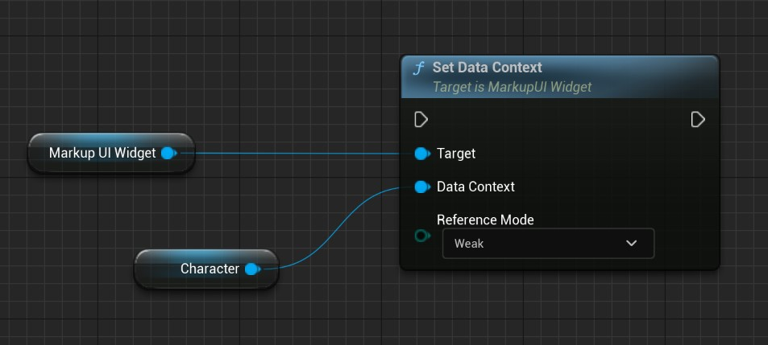
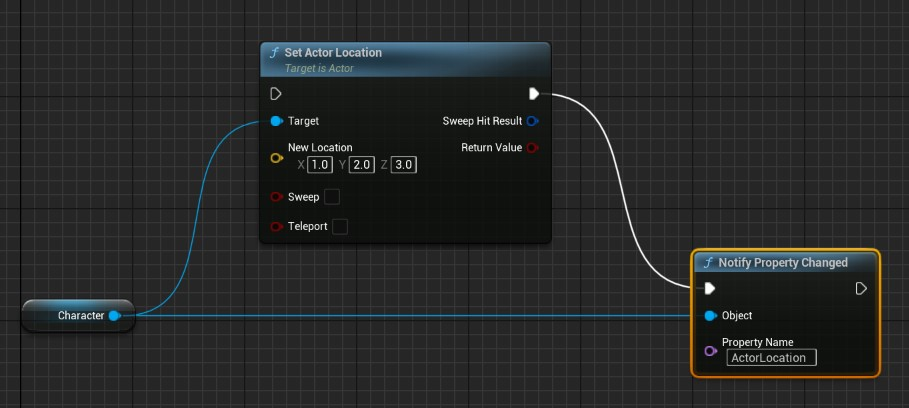
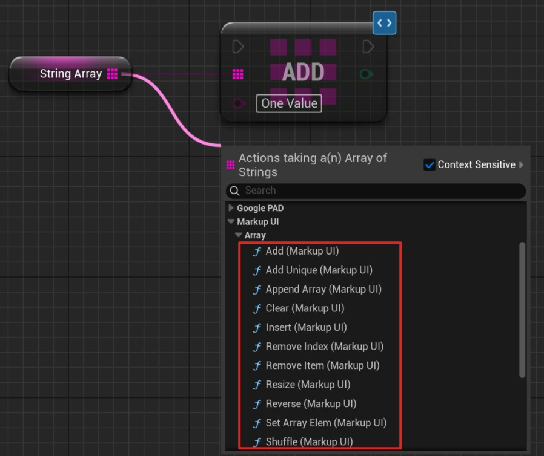
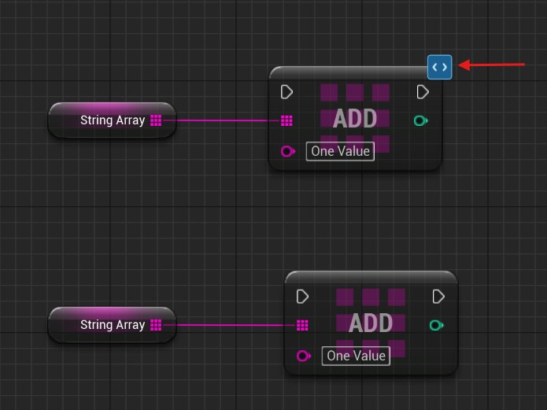

# 属性绑定

Markup UI 原生支持将可观察对象绑定到 UI，在属性或集合发生变化时更新界面，具体用法见[可观察对象与集合](../../binding/observable-objects.md)。

对于 Unreal Engine，还支持将原生 `UObject` 作为页面的数据上下文，绑定其反射属性，包括数值、字符串、对象引用、`USTRUCT` 以及 `TArray`、`TMap`、`TSet` 等原生集合。数据上下文的基本概念见[数据上下文](../../concepts/data-context.md)。

## 属性绑定的支持范围

数据上下文可以是已有的 `UObject`、Actor 或其他 `UObject` 派生对象，也可以是蓝图对象。Markup UI 通过 Unreal Engine 的反射系统读取属性；C++ 字段需要声明为 `UPROPERTY`，蓝图中则可使用对象的变量。

### UPROPERTY

例如，对象中声明以下属性：

```cpp
UPROPERTY(EditAnywhere, BlueprintReadWrite, Category = "Player")
int32 Health = 100;
```

HTML 使用属性名读取其值：

```html
<p>Health: {{ Health }}</p>
```

使用属性的实际名称编写绑定。需要从蓝图访问时，使用适当的蓝图可见性设置；双向绑定要求属性可写，`BlueprintReadOnly` 和只读属性不能作为写回目标。

### Get/Set UFUNCTION

除变量外，也可以通过公开的 Unreal 反射函数提供属性。`GetHealth()` 对应绑定名称 `Health`；可选的 `SetHealth(...)` 允许写回：

```cpp
UFUNCTION(BlueprintCallable, Category = "Player")
int32 GetHealth() const;

UFUNCTION(BlueprintCallable, Category = "Player")
void SetHealth(int32 Value);
```

- **Getter**：不接收参数，返回一个受支持类型的值。
- **Setter**：接收一个参数，其类型必须与 Getter 的返回类型相同；不返回值。

只有 Getter 时，属性为只读；只有 Setter、没有 Getter 时，无法通过这组函数绑定属性。如果存在同名 `UPROPERTY`，绑定优先使用该属性。

`UPROPERTY` 也可以通过 `BlueprintGetter` 和 `BlueprintSetter` 指定访问函数。绑定使用属性名，并通过指定的函数读取或写入：

```cpp
UFUNCTION(BlueprintGetter)
int32 GetHealth() const;

UFUNCTION(BlueprintSetter)
void SetHealth(int32 Value);

UPROPERTY(BlueprintGetter = GetHealth, BlueprintSetter = SetHealth)
int32 Health = 100;
```

!!! note "集合属性的访问方式"
    `TArray`、`TMap` 和 `TSet` 必须作为对象的实际属性提供；返回集合副本的 Getter 不能作为可观察集合使用。

### 支持的数据类型

| Unreal Engine 类型 | 读取方式 | 通过绑定写回 |
| --- | --- | --- |
| `bool` | 布尔值 | 属性可写时支持 |
| `int8`、`int16`、`int32`、`int64` | 对应宽度的有符号整数 | 属性可写时支持 |
| `uint8`、`uint16`、`uint32`、`uint64` | 对应宽度的无符号整数 | 属性可写时支持 |
| `float`、`double` | 浮点数 | 属性可写时支持 |
| `FString`、`FText`、`FName` | 字符串 | 属性可写时支持 |
| 枚举 | 底层整数值 | 属性可写时支持 |
| `UObject*`、`TObjectPtr<T>`、`TWeakObjectPtr<T>` | 对象，可继续访问其反射属性 | 不支持替换对象引用；对象自身的可写标量属性可写回 |
| `USTRUCT` | 结构值，可继续访问其反射成员 | 结构体及其成员均只读 |
| `TArray<T>`、`TMap<TKey, TValue>`、`TSet<T>` | 原生集合，可遍历或按支持的方式读取元素 | 不支持整体赋值；游戏代码修改后发送集合通知 |
| `TOptional<T>` | 有值时读取内部值，未设置时为空值 | 内部为可写标量时支持，写入空值可清除 |

标量写回仍受属性可写性和 Getter／Setter 配置限制。`TOptional<T>` 的内部类型不能是集合或结构体。软对象引用和委托不支持属性绑定。

### USTRUCT

`USTRUCT` 是值类型，不是独立的 `UObject`。绑定时需要注意：

- **成员读取**：使用 `Profile.Level` 这样的路径；自定义结构体需要声明为 `USTRUCT`，供绑定读取的成员需要声明为 `UPROPERTY`。
- **只读访问**：结构体及其成员不支持双向写回，即使成员声明了 `BlueprintReadWrite`。
- **变更通知**：修改成员后，通知所属 UObject 的整个结构属性，例如 `Profile`，而不是发送 `Profile.Level` 通知。
- **集合元素**：修改数组或字典中的结构体元素时，发送该元素的替换通知。
- **内置结构体**：`FVector`、`FColor`、`FLinearColor` 等也按结构体读取，适用相同的只读和通知规则。

例如，定义一个包含等级的结构体，并将其作为数据对象的属性：

```cpp
USTRUCT(BlueprintType)
struct FPlayerProfile
{
    GENERATED_BODY()

    UPROPERTY(EditAnywhere, BlueprintReadWrite, Category = "Player")
    int32 Level = 1;
};
```

在数据对象类中声明：

```cpp
UCLASS(BlueprintType)
class UPlayerData : public UObject
{
    GENERATED_BODY()

public:
    UPROPERTY(EditAnywhere, BlueprintReadWrite, Category = "Player")
    FPlayerProfile Profile;
};
```

HTML 按成员路径读取：

```html
<p>等级：{{ Profile.Level }}</p>
```

游戏代码修改成员后，为 `Profile` 发送通知：

```cpp
#include "Binding/UObjectBinding.h"
#include "PlayerData.h"

PlayerData->Profile.Level = 2;
MarkupUI::Binding::NotifyPropertyChanged(
    PlayerData, GET_MEMBER_NAME_CHECKED(UPlayerData, Profile));
```

蓝图中修改结构成员后，同样调用 **Notify Property Changed**，将 **Object** 连接到数据对象，将 **Property Name** 设为 `Profile`。

下方示例中的 `PlayerData` 代表已有的数据对象，假设它具有 `Health`、`Items`、`Scores` 和 `Tags` 属性。

## 设置数据上下文

=== "蓝图"

    1. 创建或取得数据对象，并使用变量保存该对象。
    2. 取得 **MarkupUI Widget** 的引用，调用 **Set Data Context**。
    3. 将数据对象连接到 **Data Context**，并按需要设置 **Reference Mode**。

    

=== "C++"

    将已有对象传给 `MarkupUIWidget`：

    ```cpp
    #include "UMG/MarkupUIWidget.h"
    #include "PlayerData.h"

    // Widget 和 PlayerData 分别指向已有的 MarkupUIWidget 和数据对象。
    Widget->SetDataContext(PlayerData);
    ```

    数据上下文可在打开页面之前或之后设置。

### 对象生命周期

**Reference Mode** 支持以下引用方式：

- **Weak**（默认）：`MarkupUIWidget` 不会阻止数据对象被 GC。请由游戏中的其他对象通过有效的 Unreal 引用持有数据对象，确保页面使用期间对象仍然有效。
- **Strong**：`MarkupUIWidget` 持有数据对象的强引用，阻止对象被 GC。清除上下文或替换为其他对象时，对该上下文的持有随之更新。

### 命名数据上下文

使用 **Set Named Data Context** 或 C++ 的 `SetNamedDataContext` 设置带名称的上下文：

```cpp
Widget->SetNamedDataContext(TEXT("player"), PlayerData);
```

在页面中通过 `@context="player"` 选择它。使用 **Reset Data Context** 清除默认上下文，使用 **Reset Named Data Context** 清除指定名称的上下文；名称和页面中的写法必须一致。

## 原生集合

作为 `UObject` 属性声明的集合可以直接用于绑定：

| Unreal Engine 类型 | 绑定中的用途 |
| --- | --- |
| `TArray<T>` | 有序列表，可按下标读取元素 |
| `TMap<TKey, TValue>` | 按键读取或遍历键值对 |
| `TSet<T>` | 遍历不重复的元素，不支持下标访问 |

集合元素必须是绑定支持的类型，不能直接嵌套原生集合。`TMap` 的键支持字符串和整数类型；集合绑定语法见[集合绑定](../../binding/collection-binding.md)。

!!! warning "集合必须是对象的实际属性"
    将集合声明为对象上的反射属性，并操作该属性本身。返回集合副本的 getter 无法提供可观察的原始集合，不能用副本代替原集合发送通知。

## 属性更改通知 {#property-change-notification}

游戏代码或蓝图修改数据对象后，需要发送属性更改通知，页面绑定才能重新读取该属性。首次绑定时读取当前值，不要求为初始赋值预先发送通知。

### FieldNotify

支持 FieldNotify 的对象发出字段广播后，插件会自动更新对应绑定，无需重复发送手动通知。接入步骤及 C++ / 蓝图示例见[UMG Viewmodel](umg-viewmodel.md)。

### 手动通知

=== "蓝图"

    1. 使用普通的 **Set** 节点修改数据对象的变量，例如 `Health`。
    2. 在赋值后调用 **Notify Property Changed**。
    3. 将同一个数据对象连接到 **Object**，将 **Property Name** 设为 `Health`。

    属性名称应与变量实际名称一致。为其他对象发送通知时，将 **Object** 连接到实际持有该属性的对象。

    例如，修改角色位置后，可通知 `ActorLocation` 属性发生变化：

    

=== "C++"

    更新属性后，调用 `MarkupUI::Binding::NotifyPropertyChanged`：

    ```cpp
    #include "MarkupUISdk.h" // Markup UI 的 SDK 和 Unreal Engine 绑定接口。
    #include "PlayerData.h"

    // PlayerData 指向页面正在使用的数据对象。
    PlayerData->Health = 80;
    MarkupUI::Binding::NotifyPropertyChanged(
        PlayerData, GET_MEMBER_NAME_CHECKED(UPlayerData, Health));
    ```

    `GET_MEMBER_NAME_CHECKED` 使用 C++ 成员名，便于编译时检查。请指定实际变化的属性。

## 集合更改通知

直接对 `TArray`、`TMap` 或 `TSet` 调用普通修改操作不会自动通知页面。修改已绑定的集合时，使用插件提供的集合操作，或在修改时发送相应通知。

集合通知分为以下类型：

- **新增（`Add`）**：创建并显示新增元素，保留其他元素。
- **删除（`Remove`）**：移除对应元素的 UI，保留其他元素。
- **替换（`Replace`）**：更新被替换元素对应的 UI，保留其他元素。
- **移动（`Move`）**：调整对应元素的显示位置。
- **重置（`Reset`）**：重新读取整个集合并刷新列表。

!!! warning "TSet 使用集合重置通知"
    `TSet` 是无序集合，元素没有稳定的位置，增删元素也可能改变遍历顺序。因此，`TSet` 内容变化时发送集合重置通知，由绑定重新读取整个集合，而不按下标报告单个元素的增删。需要保持列表顺序或按位置更新元素时，请使用 `TArray`。

### C++

=== "ObservableCollection"

    使用 SDK 的可观察集合时，通过集合自身的操作接口修改内容即可发送通知，无需再次调用通知函数。C++ 的具体集合类型是 `ObservableArray<T>`、`ObservableMap<TKey, TValue>` 和 `ObservableSet<T>`。

    ```cpp
    #include "CoreMinimal.h"
    // 必须引入 UE 专用 SDK 头文件，提供 UE 类型适配并支持编译期类型检查。
    #include "MarkupUISdk.h"

    // 将可观察集合保存在页面使用的 C++ 数据模型中。
    TArray<int32> InitialNumbers{10, 20};
    MarkupUI::Binding::Modeling::ObservableArray<int32> Numbers =
        MarkupUI::Binding::Modeling::ObservableArray<int32>::From(
            MoveTemp(InitialNumbers));
    Numbers.Add(30);
    Numbers.Set(0, 15);
    Numbers.RemoveAt(1);
    ```

    这种方式用于 SDK 的 C++ 数据模型，不能将这些类型声明为 Unreal Engine 的 `UPROPERTY`。对象上的 `TArray`、`TMap` 和 `TSet` 属性可使用下面两种方式。完整用法见[可观察对象与集合](../../binding/observable-objects.md)。

=== "NotifyCollection"

    `MarkupUI::NotifyCollection::From` 用于对象上的 Unreal Engine 原生集合 `TArray`、`TMap` 和 `TSet`，在执行修改时自动发送通知，无需再次手动通知：

    ```cpp
    #include "MarkupUISdk.h"
    #include "PlayerData.h"

    // PlayerData->Items: TArray<FString>
    // PlayerData->Scores: TMap<FString, int32>
    // PlayerData->Tags: TSet<FString>
    // These are the original collection properties on PlayerData.

    MarkupUI::NotifyCollection::From(PlayerData->Items).Add(TEXT("Potion"));
    MarkupUI::NotifyCollection::From(PlayerData->Scores).Add(TEXT("Level"), 2);
    MarkupUI::NotifyCollection::From(PlayerData->Tags).Add(TEXT("Ready"));
    ```

    `TArray` 和 `TMap` 可通知具体元素的增删或替换。

=== "代码通知"

    直接修改对象上的 Unreal Engine 原生集合 `TArray`、`TMap` 和 `TSet` 时，使用 `Binding/UObjectCollectionNotifications.h` 中的通知函数。`Begin` 在修改前调用，`End` 在对应修改后配对调用：

    ```cpp
    #include "Binding/UObjectCollectionNotifications.h"
    #include "PlayerData.h"

    // PlayerData->Items: TArray<FString>
    // PlayerData->Scores: TMap<FString, int32>
    // PlayerData->Tags: TSet<FString>
    // These are the original collection properties on PlayerData.

    MarkupUI::BeginArrayAdd(PlayerData->Items);
    PlayerData->Items.Add(TEXT("Potion"));
    MarkupUI::EndArrayAdd(PlayerData->Items);

    if (PlayerData->Items.IsValidIndex(0))
    {
        MarkupUI::BeginArrayRemove(PlayerData->Items, 0);
        PlayerData->Items.RemoveAt(0);
        MarkupUI::EndArrayRemove(PlayerData->Items);
    }

    const FString Key = TEXT("Level");
    MarkupUI::BeginMapAdd(PlayerData->Scores, Key);
    PlayerData->Scores.Add(Key, 2);
    MarkupUI::EndMapAdd(PlayerData->Scores);

    PlayerData->Tags.Add(TEXT("Ready"));
    MarkupUI::NotifySetChanged(PlayerData->Tags);
    ```

    数组替换使用 `BeginArrayReplace` / `EndArrayReplace`；字典删除使用 `BeginMapRemove` / `EndMapRemove`。数组下标、数量和字典键必须与实际修改一致。清空数组或字典后，分别调用 `NotifyArrayReset` 或 `NotifyMapReset`。

对 Unreal Engine 原生集合的修改和通知应在游戏线程进行，并始终操作被绑定的原始集合。

### 蓝图

在蓝图中选择带 **(Markup UI)** 后缀的集合修改节点，例如数组的 **Add (Markup UI)**，并将目标连接到数据对象的集合属性。节点执行集合修改并发送通知。

具体节点与选择方式见下方“Markup UI 蓝图扩展节点”。

!!! note "对象属性与集合变化"
    修改集合中的对象属性时，通知该对象的属性变化；增删集合元素时，通知集合变化。两种通知不能相互替代。

## Markup UI 蓝图扩展节点

从数组属性引脚拖出连线，可在 **Markup UI → Array** 中选择带 **(Markup UI)** 后缀的操作：



对 `TMap`、`TSet` 使用相应带 **(Markup UI)** 后缀的节点。节点需要操作对象上的原始集合属性，不要使用返回副本的函数结果。

Markup UI 节点的右上角带有蓝色标记，用于与 Unreal Engine 原生集合节点区分。下图中，上方节点会在修改集合时发送通知；下方原生节点只修改集合，不会自动发送 Markup UI 通知。



1. 从数据对象取得 `Items` 属性，并连接到数组节点的 **Target Array**。
2. 为 **Add (Markup UI)** 提供要添加的元素。
3. 执行该节点后，绑定的列表会收到集合变化通知。

**Array 节点**

| 节点 | 作用 |
| --- | --- |
| **Add (Markup UI)** | 在末尾添加元素 |
| **Add Unique (Markup UI)** | 元素不存在时添加 |
| **Append Array (Markup UI)** | 追加另一个数组的元素 |
| **Clear (Markup UI)** | 清空数组 |
| **Insert (Markup UI)** | 在指定下标插入元素 |
| **Remove Index (Markup UI)** | 删除指定下标的元素 |
| **Remove Item (Markup UI)** | 删除匹配的元素 |
| **Resize (Markup UI)** | 调整数组长度 |
| **Reverse (Markup UI)** | 反转元素顺序 |
| **Set Array Elem (Markup UI)** | 设置指定下标的元素 |
| **Shuffle (Markup UI)** | 随机打乱元素 |
| **Shuffle from Stream (Markup UI)** | 使用随机流打乱元素 |
| **Swap Array Elements (Markup UI)** | 交换两个位置的元素 |

**Map 节点**

| 节点 | 作用 |
| --- | --- |
| **Add (Markup UI)** | 添加键值对，或更新已有键的值 |
| **Remove (Markup UI)** | 删除指定键的键值对 |
| **Clear (Markup UI)** | 清空字典 |

**Set 节点**

| 节点 | 作用 |
| --- | --- |
| **Add (Markup UI)** | 添加元素 |
| **Add Items (Markup UI)** | 添加数组中的元素 |
| **Remove (Markup UI)** | 删除指定元素 |
| **Remove Items (Markup UI)** | 删除数组中指定的元素 |
| **Clear (Markup UI)** | 清空集合 |

> Array 和 Set 节点由当前 Unreal Engine 版本提供的集合函数生成，具体可用节点可能随引擎版本变化。上述名称以 Unreal Engine 5.8 为参考；读取集合时可使用 Unreal Engine 原生查询节点。

!!! note "Set 运算节点"
    **Difference**、**Intersection**、**Union** 和 **To Array** 的 `(Markup UI)` 版本目前不能作为自动通知节点使用：这些节点没有所需的 **Target Set** 输入。计算集合结果时，请使用 Unreal Engine 原生节点，再通过受支持的集合修改操作更新绑定的数据。
