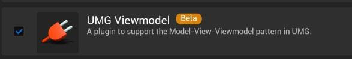
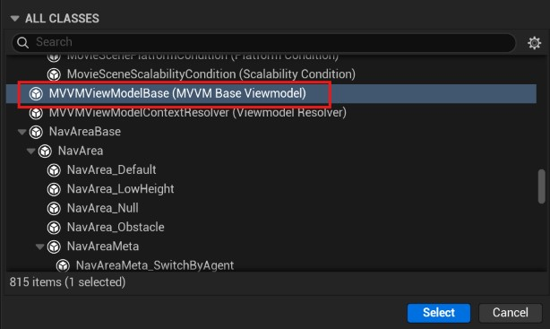
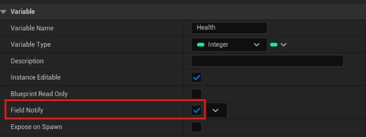
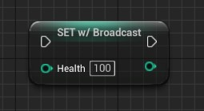

# UMG Viewmodel

使用 UE 的 **MVVMViewModelBase** 可以简化属性更改通知，蓝图中可以少调用一次 Markup UI 的 **Notify Property Changed** 节点。

UMG Viewmodel 的详细信息，请参考[官方文档](https://dev.epicgames.com/documentation/unreal-engine/umg-viewmodel-for-unreal-engine)。

!!! abstract "调用线程"
    向 Markup UI 提供数据的 FieldNotify 广播应在**游戏线程**执行。

## 与 Markup UI 集成

将支持 FieldNotify 的对象作为页面数据上下文，或通过属性路径访问该对象后，插件自动订阅其字段通知。页面继续使用普通的[属性绑定](property-binding.md)语法，不需要额外声明通知选项：

```html
<!-- 当前数据上下文提供支持 FieldNotify 的 Health 属性。 -->
<p>生命值：{{ Health }}</p>
```

Markup UI 可以接收 UE 的 FieldNotify 字段更改通知，并刷新 UI 界面。

## MVVMViewModelBase

从 `UMVVMViewModelBase` 继承的 UObject 可以通过 UE 蓝图或 C++ 发送属性更改通知。该基类已实现 `INotifyFieldValueChanged`，Markup UI 会自动接收其 FieldNotify 广播并更新页面绑定。

在 **Plugins** 中启用 **UMG Viewmodel** 插件，按编辑器要求重启。



> 使用 **MVVMViewModelBase**（C++ 类型名为 `UMVVMViewModelBase`）必须启用 **UMG Viewmodel** 插件。`INotifyFieldValueChanged` 接口本身由引擎提供，不要求启用该插件。

=== "蓝图"

    1. 创建以 **MVVMViewModelBase** 为父类的蓝图。
    
        
    
    2. 添加 `Health` 整数变量，启用其 **Field Notify**，并编译蓝图。
    
        
    
    3. 将该对象实例设置为 Markup UI 页面的数据上下文。
    4. 使用 `Health` 对应的 **Set w/ Broadcast** 节点修改值。节点广播后，页面自动更新，无需紧接着调用 **Notify Property Changed**。
    
        
    
    > 节点显示名称可能随编辑器语言而变化；**W/Broadcast** 表示该 Set 节点会广播字段变更。

=== "C++"

    ```cpp
    // PlayerViewModel.h
    #pragma once
    
    #include "CoreMinimal.h"
    #include "MVVMViewModelBase.h"
    #include "PlayerViewModel.generated.h"
    
    UCLASS(BlueprintType)
    class UPlayerViewModel : public UMVVMViewModelBase
    {
        GENERATED_BODY()
    
    private:
        // UPROPERTY 注解必须包含 FieldNotify，蓝图和 UE_MVVM_SET_PROPERTY_VALUE 才能使用该属性的更改通知。
        UPROPERTY(BlueprintReadWrite, FieldNotify, Getter, Setter,
            Category = "Player", meta = (AllowPrivateAccess = "true"))
        int32 Health = 80;
    
    public:
        int32 GetHealth() const
        {
            return Health;
        }
    
        void SetHealth(int32 Value)
        {
            // 直接给 Health 赋值不会发送通知，需要通过此宏修改并广播。
            // 仅在值发生变化时赋值并广播 Health 通知。
            UE_MVVM_SET_PROPERTY_VALUE(Health, Value);
        }
    };
    ```
    
    业务代码通过 setter 更新：
    
    ```cpp
    // PlayerViewModel 是已提供给页面的 UPlayerViewModel 实例。
    PlayerViewModel->SetHealth(60);
    ```
    
    `UE_MVVM_SET_PROPERTY_VALUE` 检查变化、赋值并广播；需要只发送通知时，可以在 ViewModel 内使用 `UE_MVVM_BROADCAST_FIELD_VALUE_CHANGED(Health)`。具体接口见 [UMVVMViewModelBase 官方 API](https://dev.epicgames.com/documentation/en-us/unreal-engine/API/Plugins/ModelViewViewModel/UMVVMViewModelBase)。

## 注意事项

- **适用对象**：`UE_MVVM_SET_PROPERTY_VALUE` 用于 UObject 的 ViewModel 通知体系，依赖 `UMVVMViewModelBase` 提供的辅助函数和字段描述；普通 C++ 类不能直接使用。
- **通过宏赋值并通知**：必须使用 `UE_MVVM_SET_PROPERTY_VALUE` 宏为字段赋值并发送更改通知，普通赋值不会发送更改通知。
- **避免重复通知**：同一次变化已发送 FieldNotify 广播时，无需再调用 Markup UI 的属性通知函数。
- **普通属性仍可绑定**：没有 FieldNotify 的属性继续使用[属性更改通知](property-binding.md#property-change-notification)。
