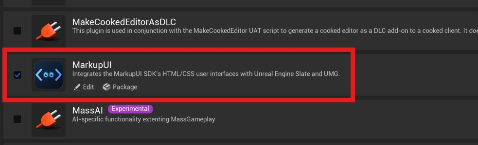

# 安装与项目准备

Markup UI 通过 Unreal Engine 插件集成到工程中。安装前请确认引擎版本、目标平台及对应构建工具链。

## 系统要求

支持平台：

- :bootstrap-windows: Windows（Win64）
- :simple-android: Android（ARM64）
- :simple-apple: iOS
- :simple-apple: macOS

### Unreal Engine

插件支持 Unreal Engine **5.5 至 5.8**。选择与工程使用的引擎版本兼容的插件发行包，并保留发行包中的平台文件。

插件依赖 Unreal Engine 的 **SVG Importer** 插件；启用 Markup UI 时，Unreal Engine 会根据插件依赖处理它。

### :bootstrap-windows: Windows

- **系统与架构**：64 位 Windows；编辑器和目标工程还需满足所用 Unreal Engine 版本的要求。
- **编译工具**：安装所用 Unreal Engine 版本支持的 Visual Studio、MSVC C++ 工具链及 Windows SDK。安装 Visual Studio 时选择 **使用 C++ 的游戏开发**工作负载。
- **UE 5.8 参考要求**：Visual Studio 2022 17.14 或更新版本、MSVC 14.38 或更新版本、Windows SDK 10.0.22621.0 或更新版本。Epic 对 UE 5.8 的通用开发推荐 Visual Studio 2026 和 MSVC 14.50。

上述版本为 Epic 的 UE 5.8 要求，不应直接当作所有引擎版本的统一要求。UE 5.5.4 的插件开发环境曾使用 MSVC 14.38.33130 验证；其他引擎版本请核对对应版本的官方说明：[Windows 硬件与软件要求](https://dev.epicgames.com/documentation/unreal-engine/hardware-and-software-specifications-for-unreal-engine){ target="_blank" rel="noopener noreferrer" }、[UE 5.8 平台 SDK 版本](https://dev.epicgames.com/documentation/unreal-engine/unreal-engine-5-8-release-notes){ target="_blank" rel="noopener noreferrer" }。

### :simple-android: Android

插件的 Android 构建支持 **ARM64（`arm64-v8a`）**。安装 Android Studio 和所用 Unreal Engine 版本对应的 Android SDK、NDK 与 JDK：

| Unreal Engine | Android Studio | Android SDK | Android NDK |
| --- | --- | --- | --- |
| 5.5 | Koala 2024.1.2 | 推荐 SDK 34，编译最低 SDK 34 | r25b |
| 5.6 | Koala 2024.1.2 | 推荐 SDK 34，编译最低 SDK 34 | r27c |
| 5.7 | Koala 2024.1.2 Patch 1 | 推荐 SDK 35 | r27c |
| 5.8 | Koala 2024.1.2 Patch 1 | 推荐 SDK 35，编译最低 SDK 34 | r27c |

版本依据：[Epic Android 开发要求](https://dev.epicgames.com/documentation/unreal-engine/android-development-requirements-for-unreal-engine?lang=en-US){ target="_blank" rel="noopener noreferrer" }。SDK 编译版本、应用目标版本和设备最低安装版本是不同设置；发布时还需满足目标商店的要求。

!!! info "Android 架构"
    当前插件不支持将 Android 的其他架构与 `arm64-v8a` 一起构建。请在工程的 Android 构建设置中选择 ARM64，并确认发行包包含对应平台文件。

### :simple-apple: macOS

在 Mac 上使用插件时，安装所用 Unreal Engine 版本对应的 macOS 和 Xcode：

| Unreal Engine | 最低 macOS 版本 | 最低 Xcode 版本 |
| --- | --- | --- |
| 5.5 | macOS Ventura 13.5 | Xcode 15.2 |
| 5.6、5.7 | macOS Sonoma 14.0 | Xcode 15.2 |
| 5.8 | macOS Sonoma 14.5 | Xcode 26.0 |

以上为 Epic 列出的 macOS 开发最低版本。推荐版本和硬件要求见 [Epic macOS 开发要求](https://dev.epicgames.com/documentation/unreal-engine/macos-development-requirements-for-unreal-engine){ target="_blank" rel="noopener noreferrer" }。UE 5.8 不兼容 Xcode 26.4。

### :simple-apple: iOS

构建 iOS 应用需要满足所用 Unreal Engine 版本要求的 macOS 与 Xcode，并完成 Apple 开发证书、描述文件和设备签名配置。使用 Windows 开发时，可按 Unreal Engine 的远程构建流程连接 Mac。

| Unreal Engine | Epic 列出的 Xcode 版本 |
| --- | --- |
| 5.5 | Xcode 15.2 |
| 5.6 | Xcode 16 |
| 5.7 | Xcode 16 |
| 5.8 | Xcode 26 |

macOS 版本、iOS SDK 和设备要求请核对 [Epic iOS 开发要求](https://dev.epicgames.com/documentation/unreal-engine/ios-ipados-and-tvos-development-requirements-for-unreal-engine){ target="_blank" rel="noopener noreferrer" }。Windows 与 Mac 的配置步骤见 [iOS 远程构建](https://dev.epicgames.com/documentation/unreal-engine/creating-remote-builds-of-unreal-engine-projects-for-ios?lang=en-US){ target="_blank" rel="noopener noreferrer" }。

## 安装插件

1. 关闭 Unreal Editor。
2. 将完整的 Markup UI 插件目录放入工程的 `Plugins/MarkupUI/`。该目录内应直接包含 `MarkupUI.uplugin`、`Source/` 和发行包提供的平台文件。
3. 打开工程。在 Unreal Editor 中选择 **Edit → Plugins**，搜索 `MarkupUI` 并启用插件。
4. 按编辑器提示重启。若提示重新构建插件，确认已安装所用引擎版本要求的 C++ 工具链后执行构建。

```text
MyProject/
  MyProject.uproject
  Plugins/
    MarkupUI/
      MarkupUI.uplugin
      Source/
      Resources/
```

!!! note "平台文件"
    目录树仅展示主要位置。请保留发行包中的其他文件，尤其是目标平台所需的库和资源；不要只复制 `MarkupUI.uplugin`。

## 检查插件安装

1. 重启编辑器后，打开 **Edit → Plugins**，确认 `MarkupUI` 和依赖的 **SVG Importer** 已启用。
2. 确认 Viewport 顶部可以打开 **Markup UI** 菜单。



安装完成后，继续[插件配置](settings.md)。
