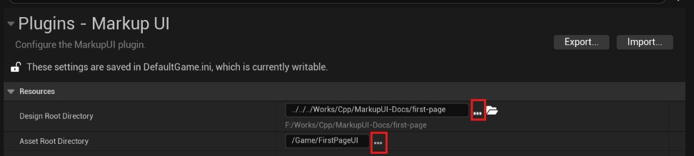
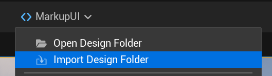
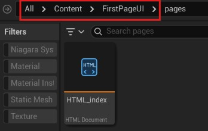
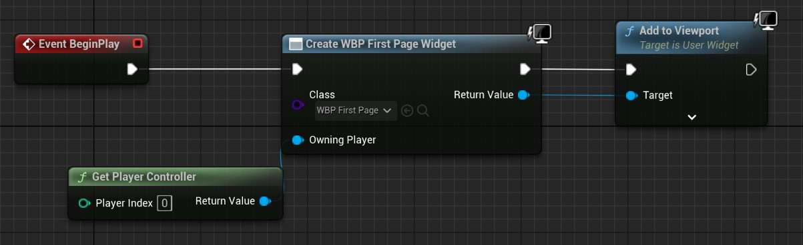
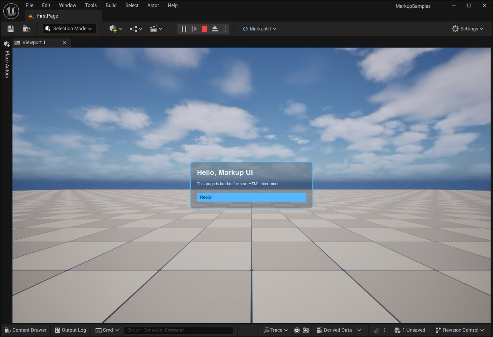

# 第一个游戏界面

将 HTML 页面导入 Unreal Engine 工程，使用 `MarkupUIWidget` 在游戏中显示一个静态信息面板。

!!! note "开始前"
    已按[安装与项目准备](install.md)启用插件，并准备[编写第一个页面](../../authoring/first-page.md)中的 `first-page/` 示例。示例包含 `pages/index.html` 和 `styles/main.css`，不需要数据上下文。

## 配置目录并导入页面

1. 在 Unreal Editor 中打开 **Edit → Project Settings**，找到 **Markup UI** 插件设置。
2. 配置以下目录：

    - **Design Root Directory（设计时目录）**：选择示例的 `first-page/`。
    - **Asset Root Directory（资产目录）**：设置为 `/Game/FirstPageUI`，对应工程的 `Content/FirstPageUI/`。
       
    

3. 在 Viewport 顶部选择 **Markup UI → Import Design Folder**（同步资产），将示例文件导入工程。   
    
4. 在 **Content Browser** 中打开 `/Game/FirstPageUI/pages/`，双击导入的 `index` HTML 文档资产，确认预览显示标题和 `Ready` 状态区域。   
    

同步时保留 `pages/` 和 `styles/` 的相对位置，使页面中的 `../styles/main.css` 能找到样式资产。

!!! tip "导入设计文件"
    也可以将 HTML、CSS 等文件单独拖入 **Content Browser** 导入。   
       
    推荐将设计素材统一放在`设计时目录`中，则可以使用 **Markup UI → Import Design Folder** 方便地同步到`资产目录`。

## 创建 Widget Blueprint

1. 在 **Content Browser** 中创建 **Widget Blueprint**，以 `User Widget` 为父类，命名为 `WBP_FirstPage`。
2. 打开 `WBP_FirstPage`，在 **Designer** 的 **Palette** 中找到 **Canvas Panel**，将其添加为根容器。
3. 在 **Palette** 中搜索 **MarkupUI Widget**，将其拖入 **Canvas Panel**。
4. 选中该控件，在 **Details → MarkupUI → Document** 中选择导入的 `index` HTML 文档资产。
5. 将控件的锚点设置为填满父容器，并将四边偏移设为 `0`。
6. 点击 **Compile** 和 **Save**。

!!! note "编辑器预览"
    HTML 文档资产编辑器可用于检查静态页面。Widget Blueprint 设计器与游戏运行时的显示结果可能不同；请在运行游戏后确认最终效果。

## 在关卡中显示

在用于测试的关卡中：

1. 打开 **Blueprints → Open Level Blueprint**。
2. 在 **Event BeginPlay** 后添加 **Create Widget** 节点，将 **Class** 设为 `WBP_FirstPage`。
3. 从 **Create Widget** 的返回值连接 **Add to Viewport**，并连接执行引脚。
   
      
   
4. 编译并保存关卡蓝图，返回编辑器后点击 **Play**。   

      

游戏开始后，屏幕应显示深色面板、标题 `Hello, Markup UI` 和 `Ready` 状态区域。`Ready` 是页面中的静态文字。

## 修改页面

1. 在`设计时目录`中修改 `pages/index.html` 或 `styles/main.css` 并保存。
2. 停止播放，通过 **Markup UI → Import Design Folder** 重新同步资产。
3. 再次点击 **Play**，检查修改后的界面。

## 检查显示问题

| 现象 | 检查项 |
| --- | --- |
| 没有显示界面 | `WBP_FirstPage` 是否已创建并添加到 Viewport；控件是否有足够的显示区域 |
| 控件存在但页面为空 | **Document** 是否指定了导入的 HTML 文档资产 |
| 页面文字显示但样式缺失 | CSS 是否已同步；`pages/` 与 `styles/` 的相对位置是否保持一致 |
| 修改后仍是旧内容 | 是否保存源文件、重新同步资产并重新开始播放 |

后续可阅读[数据绑定概述](../../binding/getting-started.md)，将游戏数据连接到页面。
