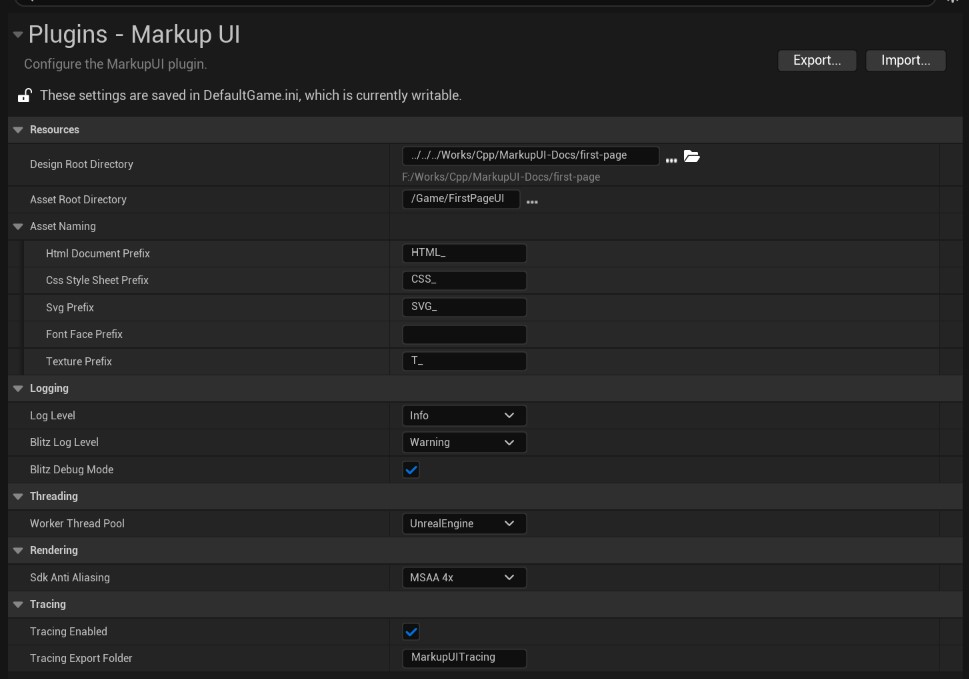

# 插件配置

在 Unreal Editor 中打开 **Edit → Project Settings → Plugins → Markup UI**，配置资源、日志、渲染、线程和追踪选项。以下默认值适用于插件的默认配置，工程可以覆盖这些值。

截图展示的是一个工程的配置示例，部分选项与默认值不同。

## 工作目录与资产命名

这些设置决定设计文件从哪里导入、资产保存在哪里，以及插件如何根据文件名查找资产。

### 设计时目录

**Design Root Directory（设计时目录）** 保存用于编辑的 HTML、CSS、图片和字体源文件。相对路径从 Unreal 工程目录计算，也可以使用绝对路径。默认值为 `MarkupUIDesign`。

### 资产目录

**Asset Root Directory（资产目录）** 保存导入 Unreal 工程后的资产，供资产预览和游戏运行时加载。默认值为 `/Game/Assets/MarkupUI`，对应工程的 `Content/Assets/MarkupUI/`。

修改后，新打开或重新加载的页面使用新配置；已经打开的页面需要重新加载，无需重启编辑器。

### 资产命名

**Asset Naming** 设置使用插件的 **Import Design Folder** 功能同步`设计时目录`时，为生成的资产自动添加的名称前缀。插件查找页面引用的资产时也使用这些规则：

| 设置 | 文件类型 | 默认前缀 |
| --- | --- | --- |
| **Html Document Prefix** | HTML 文档 | `HTML_` |
| **Css Style Sheet Prefix** | CSS 样式表 | `CSS_` |
| **Svg Prefix** | SVG 图片 | `SVG_` |
| **Font Face Prefix** | `ttf`、`otf` 字体 | 空 |
| **Texture Prefix** | PNG、JPEG 等纹理图片 | `T_` |

例如，默认规则下 `pages/index.html` 导入为 `pages` 下的 `HTML_index` 文档资产。HTML 和 CSS 中仍使用源文件的路径与文件名，插件按配置的规则查找资产。

!!! warning "修改资产命名规则"
    修改前缀不会自动重命名已有资产。新打开或重新加载的页面使用新规则；请同步调整已有资产或重新导入，并检查页面资源是否仍能找到。前缀留空表示不添加前缀；前缀必须是有效的 Unreal 资产名称字符，不能包含路径分隔符。

## 日志与诊断

这些设置控制日志输出的详细程度，以及排查问题时是否附加调用栈。

### 日志级别

**Log Level** 控制 Markup UI 插件及运行时日志的最低输出级别，默认 `Info`。可选 `Debug`、`Info`、`Warning`、`Error` 和 `Off`；`Off` 关闭普通日志输出。修改后在编辑器中立即生效。

### 页面处理日志级别

**Blitz Log Level** 控制页面处理相关日志的最低级别，默认 `Warning`，可选 `Debug`、`Info`、`Warning` 和 `Error`。它同时受 **Log Level** 限制：实际输出不会比 **Log Level** 更详细；**Log Level** 为 `Off` 时也不会输出。修改后在编辑器中立即生效。

### 调试调用栈

**Blitz Debug Mode** 控制是否为相关警告和错误附加原生调用栈，默认关闭。启用后仍受日志级别过滤，修改后在编辑器中立即生效。

## 后台工作线程

此设置选择插件执行后台工作时使用的线程池。

### 工作线程池

**Worker Thread Pool** 选择执行后台工作的线程池，默认 `UnrealEngine`：

- **UnrealEngine**：使用 Unreal Engine 的共享工作线程池。
- **MarkupUI**：使用 Markup UI 专用工作线程池。

修改后重启编辑器或应用才能生效。

## 页面抗锯齿

此设置控制页面边缘的抗锯齿效果。

### 多重采样

**Sdk Anti Aliasing** 设置页面绘制使用的多重采样抗锯齿，默认 **MSAA 4x**。可选 **Disabled**、**MSAA 2x**、**MSAA 4x**。采样级别会影响边缘平滑效果与渲染开销，应结合目标设备测试。

修改后重启编辑器或应用才能生效。

## 性能追踪

这些设置控制性能追踪及追踪文件的保存位置。

### 启用追踪

**Tracing Enabled** 控制 Markup UI 性能追踪，默认关闭。编辑器中的性能采样也需要启用此选项；修改后重启编辑器或应用才能生效。

### 追踪文件保存位置

**Tracing Export Folder** 指定追踪文件的导出目录，默认 `MarkupUITracing`。相对路径从工程的 `Saved/` 目录计算，因此默认位置是 `Saved/MarkupUITracing/`；也可以使用绝对路径。留空时不捕获到文件。

修改后重启编辑器或应用才能生效。

## 配置完成

配置`设计时目录`和`资产目录`后，可按[第一个游戏界面](quick-start.md)导入页面并在游戏中显示。
