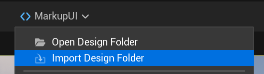

# 资产同步

资产同步将`设计时目录`中的文件导入或更新到 Unreal 工程的`资产目录`，并保留相对目录结构。插件根据[资产命名规则](../getting-started/settings.md)生成资产名称。

## 同步前

1. 在 **Edit → Project Settings → Plugins → Markup UI** 中配置`设计时目录`和`资产目录`，确保`设计时目录`存在。
2. 将需要导入的文件放入`设计时目录`。支持的文件类型及对应资产见[工作目录](working-directories.md)。
3. 停止播放，保存需要保留的工程资产。

## 同步设计文件

1. 在 Viewport 顶部打开 **Markup UI** 菜单，选择 **Import Design Folder**。

    

2. 在同步窗口中检查顶部显示的`设计时目录`和`资产目录`。
3. 在文件树中勾选需要同步的文件或文件夹。窗口只列出支持的文件；勾选文件夹会选择其中的文件。
4. 点击 **Start Sync**，等待同步完成。
5. 查看结果和失败原因，确认无误后点击 **Close**，再在 **Content Browser** 中检查并保存新增或修改的资产。

!!! warning "保存同步结果"
    同步完成后，导入或更新的资产仍处于未保存状态。请检查结果并保存需要保留的资产；同步失败时，已成功导入的资产同样需要保存。

## 同步结果

| 状态 | 含义 |
| --- | --- |
| **Added** | 新建了对应资产 |
| **Modified** | 更新了已有资产 |
| **Unchanged** | 文件与已导入内容一致，无需更新 |
| **Failed** | 导入或更新失败；查看窗口中的失败原因和 **Output Log** |

结果列表显示文件路径和资产类型。不支持的文件不会出现在选择列表中，也不会导入。两个设计文件如果按当前命名规则映射到同一个资产名称，同步会报告冲突并停止本次导入；重命名冲突文件后重新操作。

## 再次同步

修改`设计时目录`中的 HTML、CSS、图片或字体后，保存源文件并再次执行 **Markup UI → Import Design Folder**。选择需要更新的文件，确认结果后保存资产。内容未变化的文件会显示为 **Unchanged**。

!!! note "同步不会删除资产"
    同步只会添加新资产或更新已有资产。删除`设计时目录`中的文件后，再次同步不会删除`资产目录`中对应的旧资产；不再需要的资产需在 **Content Browser** 中自行处理。

同步更新工程资产，不会自动重新打开正在显示的页面。请重新加载页面或重新开始播放，再检查更改。

## 单独导入和重新导入

也可以将 HTML、CSS 等支持的文件拖入 **Content Browser** 导入，或对已有资产使用 Unreal Engine 的重新导入操作。单独导入时，同样需要将资产放在`资产目录`的对应位置，并与页面引用的相对路径保持一致。

## 常见问题

| 现象 | 检查项 |
| --- | --- |
| 无法开始同步 | `设计时目录`是否存在、`资产目录`是否有效，文件树中是否已勾选文件 |
| 文件未出现在列表中 | 文件类型是否受支持，文件是否位于`设计时目录`内 |
| 提示资产名称冲突 | 检查结果中列出的源文件和当前前缀规则，调整冲突名称后重试 |
| 同步后页面没有变化 | 是否保存资产并重新加载页面，HTML 与 CSS 引用路径是否正确 |
| 个别文件导入失败 | 查看结果中的失败原因和 **Output Log**，确认目标资产及源文件可访问 |

资源域和路径规则见[工作目录](working-directories.md)，图片与字体的导入及引用见[图片与字体](images-and-fonts.md)。
