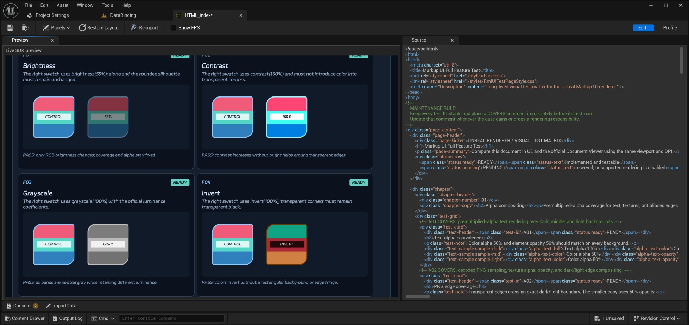
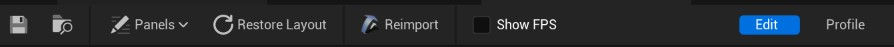
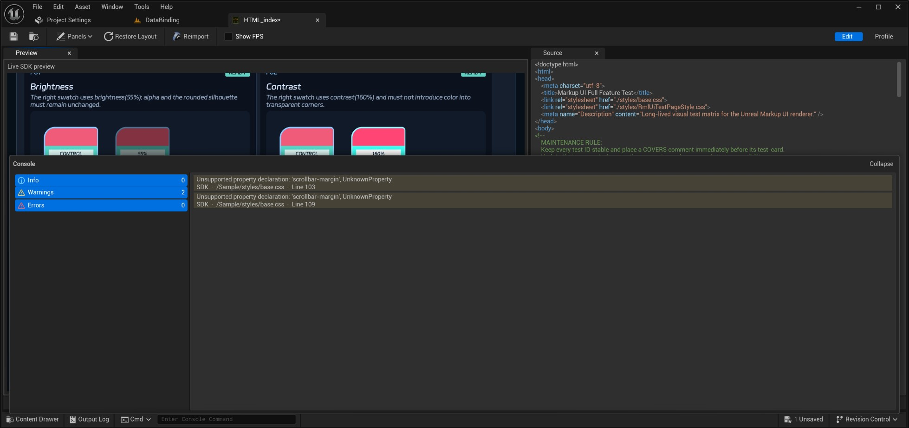

# 编辑器预览

HTML 文档资产编辑器提供页面预览、源代码查看和诊断信息，可在运行游戏前检查导入后的页面。

## 打开页面预览

1. 在 **Content Browser** 中找到导入的 HTML 文档资产，例如 `HTML_index`。
2. 双击资产，打开 **HTML Editor**。
3. 选择 **Edit** 模式，在 **Preview** 面板检查页面内容、图片、文字和布局。
4. 调整面板大小，检查页面在不同可用区域内的显示效果。

!!! note "预览使用工程资产"
    预览从`资产目录`加载导入的资产，不直接读取`设计时目录`中的源文件。资源缺失时，请检查对应资产及页面引用路径。

## 工具栏

HTML 文档资产编辑器的工具栏提供以下操作：

- **Save**：保存当前资产。
- **Browse to Asset**：在 **Content Browser** 中定位当前资产。
- **Panels**：显示或隐藏预览、源代码、追踪和控制台等面板。
- **Restore Layout**：恢复当前模式的默认面板布局。
- **Reimport**：从源文件重新导入当前资产。
- **Show FPS**：显示预览的重绘频率和间隔。
- **Edit**：查看页面预览、源代码和诊断信息。
- **Profile**：对预览页面进行性能采样和追踪分析。

> **Profile** 模式需要在[插件配置](../getting-started/settings.md)中启用追踪并重启编辑器。**Show FPS** 包含编辑器调度与节流的影响，不能直接作为页面执行时间或 GPU 耗时。

## 查看源代码和导入信息

- **Source**：查看导入到当前 HTML 文档资产中的源代码；该面板为只读。
- **ImportData**：查看资产的导入信息。
- **Console**：查看预览过程中的诊断信息。面板可通过 **Panels** 菜单显示或隐藏。

CSS 样式资产也可以双击打开，在 **Source** 中查看导入的 CSS；页面显示效果应在引用该样式的 HTML 文档预览中检查。

## 更新预览

修改源文件后，可通过[资产同步](asset-synchronization.md)更新需要的资产，或在 HTML／CSS 资产编辑器中点击 **Reimport**，重新导入当前资产。确认同步或重新导入结果后保存资产，再打开 HTML 文档检查预览；如果预览仍显示旧内容，关闭并重新打开文档资产。

!!! note "重新导入的范围"
    **Reimport** 针对当前打开的资产。HTML、CSS、图片或字体有多项修改时，使用资产同步选择并更新相关文件。

## 诊断与检查

如果页面未按预期显示，打开 **Console** 和 Unreal Editor 的 **Output Log**，检查提示中的资源路径及错误信息：

| 现象 | 检查项 |
| --- | --- |
| 预览无法打开 | 文档资产是否位于配置的`资产目录`内，检查 **Output Log** |
| 文字显示但没有样式 | CSS 是否已导入，引用路径与资产目录结构是否一致 |
| 图片未显示 | 图片资产是否存在，文件名、扩展名和资产命名规则是否一致 |
| 文字显示为方框 | 字体是否已导入，字体路径是否正确，字体是否包含所需字形 |
| 修改后仍显示旧内容 | 是否重新同步或重新导入并保存资产，是否重新打开文档预览 |

## 预览与游戏运行

资产编辑器用于检查页面和资源；游戏中的控件尺寸、DPI、输入与业务数据需要在实际界面中验证。将页面放入游戏界面的方法见[第一个游戏界面](../getting-started/quick-start.md)。

