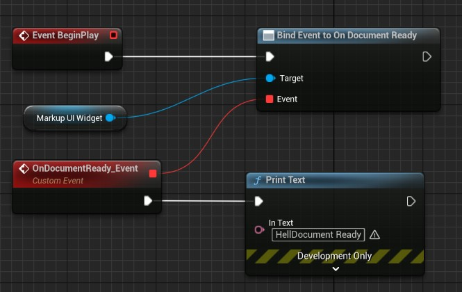
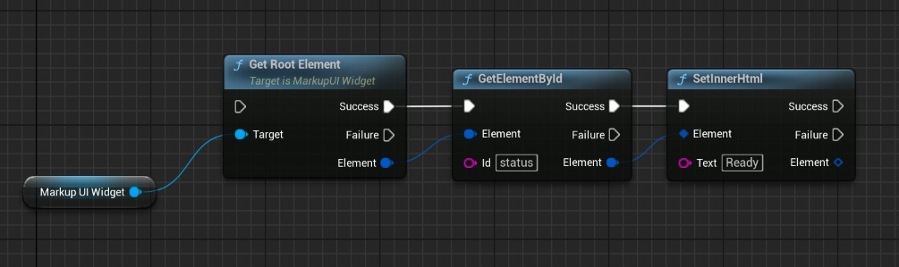
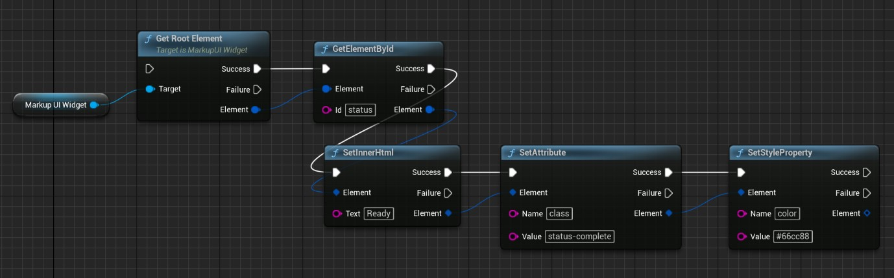
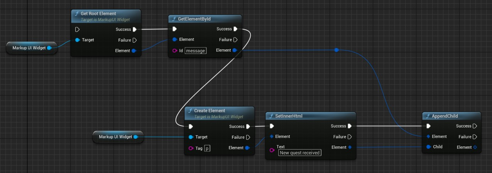
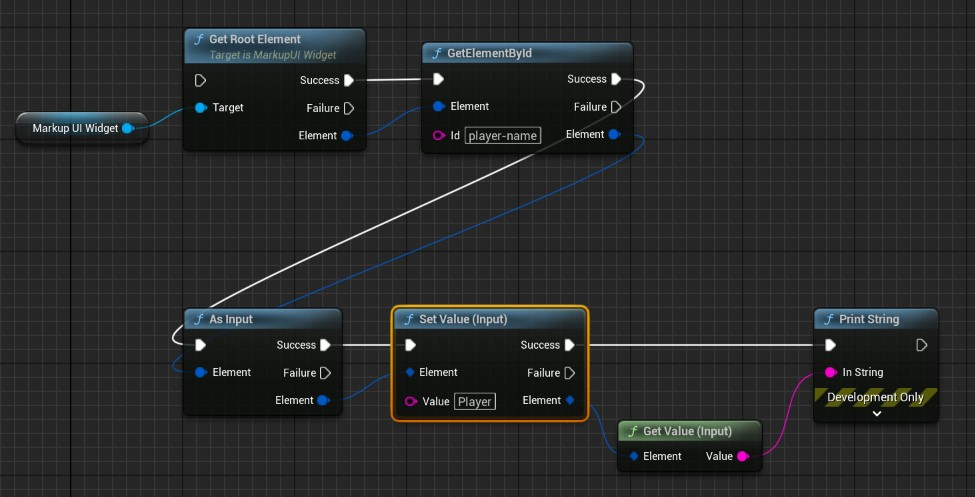
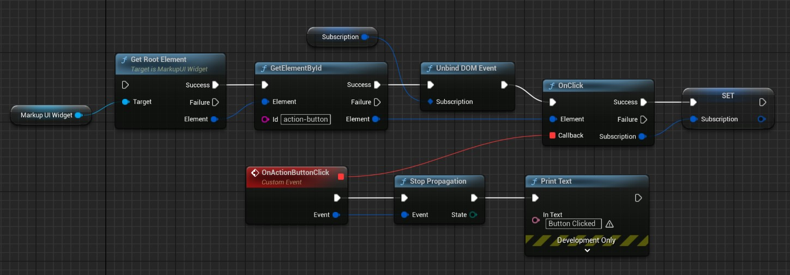

# 操作界面元素

除了通过数据绑定更新界面，你也可以在游戏运行时直接查找和操作页面中的元素，例如修改提示文字、调整样式、动态添加内容或监听按钮点击。这些接口统称为 DOM 操作。

> DOM（文档对象模型）将 HTML 页面表示为可通过程序访问的元素树。Markup UI 的 DOM 操作方式类似于浏览器中使用 JavaScript 查找元素、修改内容与样式、监听事件，但通过 C++ 或蓝图接口完成，具体支持范围以本页接口为准。概念与 JavaScript 示例可参考 [MDN DOM 文档](https://developer.mozilla.org/zh-CN/docs/Web/API/Document_Object_Model){ target="_blank" rel="noopener noreferrer" }，现行标准见 [WHATWG DOM Standard](https://dom.spec.whatwg.org/){ target="_blank" rel="noopener noreferrer" }。

!!! tip "最佳实践"
    推荐通过数据绑定和属性、集合更改通知刷新界面。直接操作界面元素涉及同步锁，应保持操作简短，避免在连续操作中执行耗时逻辑或长时间占用，以免阻塞界面更新。

持续跟随游戏数据变化的内容适合使用[属性绑定](../binding/property-binding.md)，按钮触发业务函数可使用[命令绑定](../binding/command-binding.md)。直接操作元素适合需要明确控制某个元素的场景；同一项内容同时由绑定和代码修改时，后续绑定更新可能覆盖手动设置的结果。

## OnDocumentReady

**后续所有元素操作都必须在文档就绪后执行。** 在控件的 **On Document Ready** 事件触发后，才可以获取根元素、查找元素、修改内容与样式、创建元素、读写控件值或注册事件监听。

打开文档操作完成不等于页面已经就绪，不能用打开操作的完成回调代替 **On Document Ready**。页面切换或重新加载后，应等待新文档的就绪事件，再获取新页面的元素并执行操作。

在打开文档前绑定就绪事件，在回调中输出日志：

=== "蓝图"

    使用 **Bind Event to On Document Ready** 绑定自定义事件，在事件中通过 **Print Text** 输出日志。

    

=== "C++"

    在打开文档前绑定就绪事件。以下代码假定当前对象中定义了 `HandleDocumentReady` 回调：

    ```cpp
    Widget->OnDocumentReady.AddDynamic(this, &ThisClass::HandleDocumentReady);
    ```

    在回调中输出日志，后续元素操作也可以从这里开始：

    ```cpp
    UFUNCTION()
    void HandleDocumentReady()
    {
        UE_LOG(LogTemp, Log, TEXT("Document Ready"));
    }
    ```

## 获取与查找元素

通过控件的 `GetRootElement()` 获取根元素，再查找需要操作的元素。

例如，HTML 中定义一个带 ID 的提示元素：

```html
<p id="status">等待开始</p>
```

在页面就绪后，通过 ID 查找它：

=== "蓝图"

    

=== "C++"

    ```cpp
    #include "UMG/MarkupUIWidget.h"
    #include "Dom/MarkupDom.h"

    // Widget points to the ready MarkupUI Widget.
    auto root = Widget->GetRootElement();
    auto status = root.GetElementById(TEXT("status"));
    if (status.IsValid())
    {
        status.SetInnerHtml(TEXT("Ready"));
    }
    ```

| 操作 | 接口 |
| --- | --- |
| 按 ID 查找 | `GetElementById` |
| 按 CSS 选择器查找 | `QuerySelector`、`QuerySelectorAll` |
| 按类名查找 | `GetElementByClassName`、`GetElementsByClassName` |
| 访问父子元素 | `GetParent`、`GetChildren`、`GetChildCount` |
| 查找最近匹配的祖先元素 | `GetClosest` |

查找后先检查 `IsValid()`。页面关闭、切换或重新加载后，应从新页面重新取得元素，不要继续使用旧页面的元素。

## 修改内容与外观

使用 `SetInnerHtml` 修改元素内部内容，使用 `SetAttribute` 修改属性，使用 `SetStyleProperty` 修改样式：

=== "蓝图"

    

=== "C++"

    ```cpp
    if (status.IsValid())
    {
        status.SetInnerHtml(TEXT("Ready"));
        status.SetAttribute(TEXT("class"), TEXT("status-complete"));
        status.SetStyleProperty(TEXT("color"), TEXT("#66cc88"));
    }
    ```

`SetInnerHtml` 将内容作为 HTML 解析，并替换原有子内容；需要保留子元素时，不要用它更新整个容器。使用 `RemoveAttribute` 和 `RemoveStyleProperty` 移除对应设置。

## 动态创建与移除元素

通过控件创建元素，再将它加入页面中的容器：

=== "蓝图"

    

=== "C++"

    ```cpp
    auto list = root.GetElementById(TEXT("message"));
    if (list.IsValid())
    {
        auto message = Widget->CreateElement(TEXT("p"));
        if (message.IsValid())
        {
            message.SetInnerHtml(TEXT("New quest received"));
            list.AppendChild(message);
        }
    }
    ```

`AppendChild` 将元素追加到末尾，`InsertBefore` 将元素插入到指定子元素之前，`Remove` 将元素从页面移除。由集合绑定生成的列表，优先通过修改数据集合更新内容，避免直接改动绑定生成的元素。

## 读取与设置控件值

输入框、文本区域、下拉框和表单提供专用接口。先找到元素，再转换为对应控件；元素类型不匹配时，转换结果无效。

=== "蓝图"

    

=== "C++"

    ```cpp
    auto nameInput = root.GetElementById(TEXT("player-name")).AsInput();
    if (nameInput.IsValid())
    {
        nameInput.SetValue(TEXT("Player"));
        FString name = nameInput.GetValue();
    }
    ```

| 控件 | 转换与常用操作 |
| --- | --- |
| 输入框 | `AsInput()`，使用 `GetValue` / `SetValue` |
| 复选框与单选框 | `AsInput()`，使用 `GetChecked` / `SetChecked` |
| 文本区域 | `AsTextArea()`，使用 `GetValue` / `SetValue` |
| 下拉框 | `AsSelect()`，使用 `GetValue` / `SetValue` |
| 表单 | `AsForm()`，使用 `Submit` / `Reset` |

需要将用户输入持续写入游戏数据时，使用[输入与双向绑定](../../binding/input-and-two-way-binding.md)。

## 监听界面事件

元素提供 `OnClick`、`OnFocus`、`OnBlur` 等事件订阅接口；输入控件还提供 `OnInput`、`OnChange`，表单提供 `OnSubmit`、`OnReset`。在游戏线程注册监听，回调也在游戏线程执行。

保存注册时返回的 `FMarkupUIEventSubscription`，在不再需要监听时调用 `Unbind()`。页面切换或重新加载后，为新页面重新查找元素并建立监听。

例如，监听 ID 为 `action-button` 的按钮，点击后输出日志：

```html
<button id="action-button">Click me</button>
```

=== "蓝图"

    在页面就绪后查找 `action-button`，通过 **OnClick** 连接自定义事件，并将返回的订阅保存为变量。回调中调用 **Stop Propagation** 阻止传播，再通过 **Print Text** 输出日志。不再需要监听时调用 **Unbind DOM Event**。

    

=== "C++"

    在页面就绪后注册监听。以下假定当前对象已声明 `UFUNCTION` 回调 `HandleClick(const FMarkupUIPointerEvent& Event)`，并使用成员变量 `ClickSubscription` 保存订阅：

    ```cpp
    FMarkupUIElement Button = Widget->GetRootElement()
        .GetElementById(TEXT("action-button"));
    if (Button.IsValid())
    {
        FMarkupUIPointerEventCallback Callback;
        Callback.BindDynamic(this, &ThisClass::HandleClick);

        // 重复注册前，先解除旧订阅。
        ClickSubscription.Unbind();
        ClickSubscription = Button.OnClick(Callback);
    }
    ```

    在 `HandleClick` 回调中处理点击，并阻止事件继续向父元素传播：

    ```cpp
    UFUNCTION()
    void HandleClick(const FMarkupUIPointerEvent& Event)
    {
        UE_LOG(LogTemp, Log, TEXT("Button clicked"));
        Event.StopPropagation();
    }
    ```

    不再需要监听时解除订阅：

    ```cpp
    ClickSubscription.Unbind();
    ```

事件参数可提供目标元素等信息；需要阻止事件继续传播时使用 `StopPropagation`，需要取消可取消事件的默认行为时使用 `PreventDefault`。这些控制应在当前事件回调中完成。

如果只需让页面事件执行数据对象上的函数，可以直接在 HTML 中声明命令绑定，无需手动注册监听，详见[命令绑定](../binding/command-binding.md)。