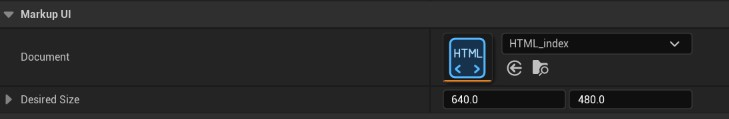
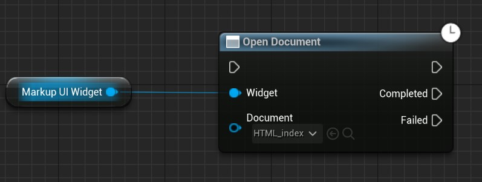

# 在 UMG 中显示页面

`MarkupUIWidget` 是承载 Markup UI 页面的 UMG 控件，可放入 Widget Blueprint，并与其他 UMG 控件组合。创建界面并将其添加到 Viewport 的完整步骤见[第一个游戏界面](../getting-started/quick-start.md)。

## UMarkupUIWidget

`UMarkupUIWidget` 继承自 `UWidget`，用于在 UMG 界面中显示 Markup UI 页面。

- **类型**：类
- **父类**：`UWidget`
- **头文件**：`UMG/MarkupUIWidget.h`
- **包含方式**：`#include "UMG/MarkupUIWidget.h"`

```cpp
class UMarkupUIWidget final : public UWidget
```

继承关系：`UObject` → `UVisual` → `UWidget` → `UMarkupUIWidget`。

### 属性

可在 Widget Blueprint 的 **Designer** 中选中 **MarkupUI Widget**，在 **Details → MarkupUI** 中配置以下属性：

| 属性 | 类型 | 说明 | 默认值 |
| --- | --- | --- | --- |
| **Document** | `UHtmlDocument*` | 控件使用的 HTML 文档资产；蓝图中可读取 | 空 |
| **Desired Size** | `FVector2D` | 控件向父容器请求的期望尺寸；蓝图中可读取和设置 | `640 × 480` |

**Document** 选择导入后的 HTML 文档资产。控件创建并同步属性时会打开该文档；未选择文档时，控件不会自动显示页面。



### 事件

| 事件 | 类型 | 说明 |
| --- | --- | --- |
| **On Document Ready** | `FMarkupUIDocumentReady` | 页面就绪、元素可以访问时触发；可在蓝图中绑定 |

!!! warning "等待页面就绪"
    必须等待 **On Document Ready** 事件触发后，才能安全访问页面元素；在此之前，页面元素不可用。

### 函数

=== "C++"

    以下是 `UMarkupUIWidget` 自身的公开函数。

    | 函数 | 说明 |
    | --- | --- |
    | `#!cpp OpenDocument(UHtmlDocument* NewDocument)` | 打开 HTML 文档资产 |
    | `#!cpp OpenDocument(const FString& Html, const FString& NewDocumentUri = FString())` | 打开 HTML 字符串，可指定文档地址 |
    | `#!cpp CloseDocument()` | 关闭当前页面 |
    | `#!cpp SetDataContext(UObject* DataContext, EMarkupUIReferenceMode ReferenceMode = EMarkupUIReferenceMode::Weak)` | 设置默认数据上下文，默认使用弱引用 |
    | `#!cpp SetDataContext(const TSharedPtr<MarkupUI::Binding::IObject>& DataContext)` | 使用接口对象设置默认数据上下文 |
    | `#!cpp ResetDataContext()` | 清除默认数据上下文 |
    | `#!cpp SetNamedDataContext(const FString& Name, UObject* DataContext, EMarkupUIReferenceMode ReferenceMode = EMarkupUIReferenceMode::Weak)` | 设置命名数据上下文，默认使用弱引用 |
    | `#!cpp SetNamedDataContext(const FString& Name, const TSharedPtr<MarkupUI::Binding::IObject>& DataContext)` | 使用接口对象设置命名数据上下文 |
    | `#!cpp ResetNamedDataContext(const FString& Name)` | 清除指定名称的数据上下文 |
    | `#!cpp GetRootElement()` | 获取页面根元素 |
    | `#!cpp CreateElement(const FString& Tag)` | 根据标签名创建元素 |
    | `#!cpp IsDocumentReady()` | 检查页面是否就绪 |

=== "蓝图"

    以下函数可通过 **MarkupUI Widget** 引用调用。

    | 函数 | 说明 |
    | --- | --- |
    | **Set Data Context** | 设置默认数据上下文，默认使用弱引用 |
    | **Reset Data Context** | 清除默认数据上下文 |
    | **Set Named Data Context** | 设置命名数据上下文，默认使用弱引用 |
    | **Reset Named Data Context** | 清除指定名称的数据上下文 |
    | **Get Root Element** | 获取页面根元素 |
    | **Create Element** | 根据标签名创建元素 |
    | **Is Document Ready** | 检查页面是否就绪 |

    **Open Document**、**Open Document (Html)** 和 **Close Document** 是作用于该控件的独立异步蓝图节点，下方“运行时打开和关闭页面”介绍了它们的用法。

> 以上列出控件自身定义的属性、事件和函数；继承成员仍可按 Unreal Engine 的方式使用。

## 控件尺寸

**Desired Size** 是控件向父容器提供的期望尺寸，不保证最终尺寸。实际显示区域由父容器、布局规则及可用空间决定。

- 在 **Canvas Panel** 中，可通过锚点和偏移设置控件占用的区域。
- 在其他 UMG 容器中，可根据容器的填充、对齐和尺寸规则调整控件。
- 页面中的百分比和布局相对于控件的页面视口计算；改变控件尺寸后，应检查页面内容是否仍完整显示。

控件尺寸、DPI 和页面缩放的关系见 [DPI 与缩放](dpi-and-scaling.md)。

## 运行时打开和关闭页面

需要在游戏过程中切换页面时，可使用蓝图节点操作已有的 **MarkupUI Widget**：

| 节点 | 作用 |
| --- | --- |
| **Open Document** | 打开指定的 HTML 文档资产 |
| **Open Document (Html)** | 打开 HTML 字符串，可通过 **Document Uri** 提供资源路径的基址 |
| **Close Document** | 关闭当前页面 |

例如，在 Widget Blueprint 的 **Graph** 中取得 **MarkupUI Widget** 的引用，调用 **Open Document** 并传入目标文档资产。处理完毕后，可以调用 **Close Document**。这些节点提供 **Completed** 和 **Failed** 引脚，用于处理操作结果。



!!! note "文档打开与页面就绪"
    **Open Document** 的 **Completed** 表示打开操作已被接受，不表示页面元素已经可供访问。需要访问页面元素时，使用控件的 **On Document Ready** 事件，或通过 **Is Document Ready** 检查状态。

HTML 文档资产的资源路径根据资产在`资产目录`中的位置解析；根路径 `/` 从全局配置的`资产目录`开始查找。详细规则见[工作目录](../resources/working-directories.md)。

### 切换与重新加载

在同一个 **MarkupUI Widget** 上调用 **Open Document** 并传入另一个文档资产，即可切换页面；传入当前文档资产则会重新加载页面。对于 HTML 字符串，使用当前内容和需要的 **Document Uri** 再次调用 **Open Document (Html)** 即可重新加载。

打开新页面时，控件会先关闭当前页面，无需先调用 **Close Document**。切换或重新加载会创建新页面；需要保留的数据应保存在数据上下文或其他游戏对象中，并在新页面就绪后重新获取需要操作的元素。

修改`设计时目录`中的文件后，先[同步资产](../resources/asset-synchronization.md)并保存，再重新加载页面。同步资产不会自动重新打开正在显示的页面。

### Document Uri 地址格式

使用 **Open Document (Html)** 打开 HTML 字符串时，可通过 **Document Uri** 指定该字符串在`资产目录`中的虚拟 HTML 文档位置。加载 HTML 引用的 CSS、图片等资源时，相对路径以该文档所在目录为起点解析。地址使用以下格式：

```text
markupui-asset:///相对于资产目录的页面路径
```

例如，**Document Uri** 设置为 `markupui-asset:///pages/index.html`，页面中的相对路径以 `pages/` 为起点：

```html
<link rel="stylesheet" href="../styles/main.css">
```

该引用指向`资产目录`中的 `styles/main.css`。虚拟文档位置仅用于确定资源路径的解析基址，无需在该位置实际创建 HTML 文档资产。

**Document Uri** 可以留空；此时使用默认的内存地址 `memory:///widget.html`，不会以`资产目录`作为相对路径的基址。需要引用`资产目录`中的资产时，应设置 `markupui-asset:///` 地址。

## 数据与交互

每个控件承载自己的页面实例。页面需要游戏数据时，可在控件上设置默认或命名数据上下文；页面中的事件可以绑定到上下文提供的命令。具体操作见[属性绑定](../binding/property-binding.md)和[命令绑定](../binding/command-binding.md)。

页面显示后，还需要根据界面用途配置 Unreal Engine 的输入模式、鼠标光标和焦点。控件本身是否可见与是否能够接收输入是不同的设置；交互行为应在运行时验证。

## 常见问题

| 现象 | 检查项 |
| --- | --- |
| 控件区域为空 | **Document** 是否已设置，或运行时打开节点是否执行并连接了有效文档资产 |
| 页面显示不完整 | 父容器分配的尺寸、锚点和偏移是否符合预期 |
| 页面没有样式或图片 | 文档及引用的资产是否位于`资产目录`内，路径和命名规则是否正确 |
| 输入框无法使用 | 控件是否获得焦点，游戏的输入模式和光标设置是否允许界面交互 |
| 打开后无法立即访问元素 | 等待 **On Document Ready**，并检查打开操作是否失败 |

可在[编辑器预览](../resources/editor-preview.md)中检查文档资产和资源诊断。
